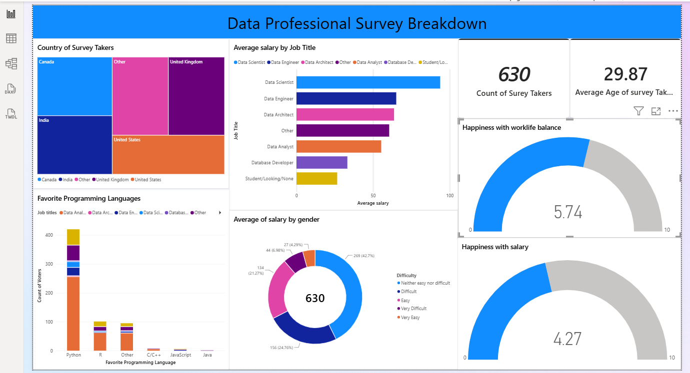

# Data Professional Survey Analysis

Data analysis and interactive dashboard development using Microsoft Power BI.

## Dashboard Preview

## Tools Used
- Microsoft Power BI
- Power Query
- DAX
- Excel

## Project Files

- `Project.xlsx` – Survey dataset
- `final.pbix` – Power BI dashboard
- `dashboard.png` – Dashboard screenshot

## Project Overview
Analyzed survey responses from data professionals to understand
salary trends, job roles, programming language preferences,
and other industry insights.
